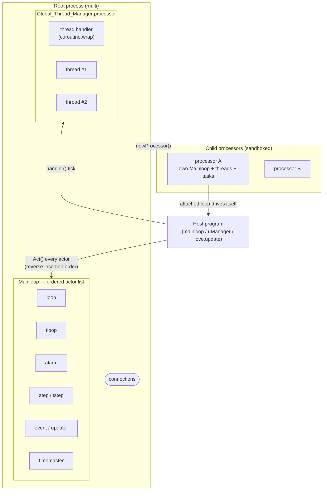
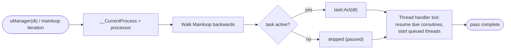
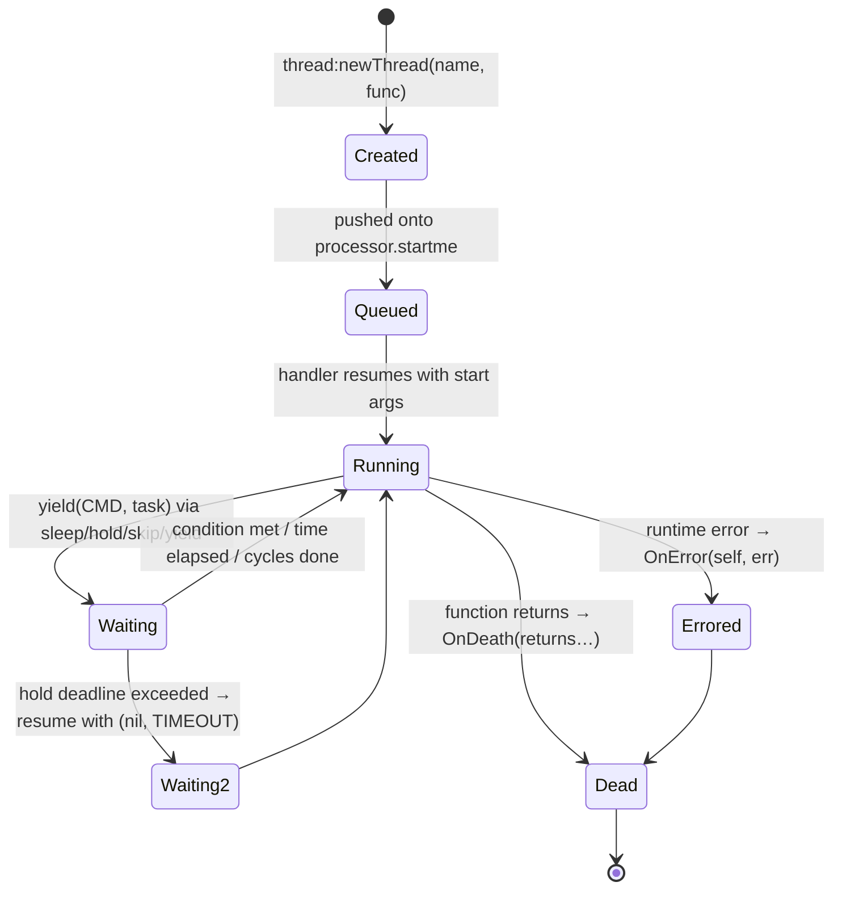

# Multi — Documentation

**Version:** 16.3.0-testing · **License:** MIT (Ryan Ward) · **Lua compatibility:** 5.1, 5.2, 5.3, 5.4, LuaJIT

Multi is a cooperative multitasking library for Lua. It provides a structured event loop, coroutine-based threads, composable event connections, timers and schedulers, isolated sub-processors, and (with optional integrations) real OS-level system threading for LÖVE 2D, Lanes, lovr, and others — all behind one consistent API.

---

## Documentation Map

| Document | Contents |
|---|---|
| **Documentation.md** (this file) | Overview, installation, quick start, architecture, runners, settings |
| [Core API](core-api.md) | Types, actors (loop/alarm/step/event/updater), timers, connections & operators, priority system, utilities, logging, UUIDs |
| [Threading & Scheduling API](threading-api.md) | Coroutine threads, yield primitives, threaded functions (TFunc), processors, services, tasks, scheduled jobs |
| [System Threading & Integrations](integrations.md) | OS threads, `GLOBAL`/`THREAD` namespaces, shared queues/tables/job queues, proxies, environment managers (love/lanes/pseudo/lovr/luvit/effil), debug & priority managers |
| [Advanced Patterns](advanced-patterns.md) | Recipes, pipelines, performance tuning, pitfalls |
| [Quick Reference](quick-reference.md) | One-page cheat sheet |

> The file `multi_library_documentation.md` is a legacy single-file document; it now redirects to this suite. The authoritative changelog lives in [changes.md](changes.md).

---

## Table of Contents (this page)

1. [Philosophy & Key Concepts](#philosophy--key-concepts)
2. [Installation](#installation)
3. [Quick Start](#quick-start)
4. [Architecture](#architecture)
5. [Execution Model: Runners](#execution-model-runners)
6. [Initialization & Settings](#initialization--settings)
7. [Running the Test Suite](#running-the-test-suite)
8. [Getting Help](#getting-help)

---

## Philosophy & Key Concepts

Lua is single-threaded. Multi does not change that; it gives you **cooperative concurrency**: many tasks share one Lua state, and each task *voluntarily* yields control so others can run. On top of that, optional integrations add **true OS threads** with message-passing semantics.

| Concept | Description |
|---|---|
| **Actor** | Any object scheduled in a processor's `Mainloop`. Every actor has an `Act()` method called by the scheduler (`loop`, `tloop`, `alarm`, `step`, `tstep`, `event`, `updater`, `timemaster`). |
| **Connection** | A multi-cast event channel. Producers call `:Fire(...)`, subscribers call `:Connect(func)` or the shorthand `conn(func)`. Connections support operator overloads (`+`, `*`, `%`, `/`, `..`) for composing event pipelines. |
| **Thread** | A Lua coroutine managed by a scheduler handler. Inside a thread you call `thread.sleep`, `thread.hold`, `thread.yield`, etc. to yield. Threads have `OnError`/`OnDeath` connections. |
| **Processor** | An isolated sub-scheduler with its own actor list, thread pool, task queue, and limits (`MaxThreads`, `MaxObjects`). Stop a processor and everything inside it stops. |
| **Thread Manager** | A special, always-running processor (`Global_Thread_Manager`) that hosts every thread created directly on `multi`. |
| **Priority** | A numeric weight (powers of 4) that controls how often an actor's `Act()` runs when the priority-aware runner is enabled. |
| **TFunc (threaded function)** | A callable object that runs its body in a thread and hands you a handle with `wait()`, `connect()`, `OnReturn`, `OnError`, `OnStatus`. |
| **System thread** | A real OS thread (LÖVE, Lanes, lovr…) created through the integration layer, communicating via `GLOBAL`, channels/Linda objects, and the shared threaded objects. |

Every multi object shares a common lifecycle interface: `Pause()`, `Resume()`, `Destroy()`, `isPaused()`, `isActive()`, `setPriority()`, `setName()` — see [Core API → Universal Actor Methods](core-api.md#universal-actor-methods).

---

## Installation

Multi is pure Lua. Copy the `multi/` folder into your project (or install from luarocks):

```
luarocks install multi
```

Then make sure the folder is on your Lua path, e.g.:

```lua
package.path = "?/init.lua;?.lua;" .. package.path
local multi, thread = require("multi"):init()
```

### Optional dependencies

| Dependency | Installs | Enables |
|---|---|---|
| [LÖVE 2D](https://love2d.org/) | game engine | OS system threads via `love.thread`, threaded queues/tables/job queues |
| [Lanes](https://github.com/LuaLanes/lanes) | `luarocks install lanes` | OS system threads via Linda objects (console Lua) |
| [chronos](https://github.com/ldrumm/chronos) | `luarocks install chronos` | high-precision clock + time-based priority management ([priorityManager](integrations.md#prioritymanager)) |
| lovr | game framework | experimental system threading (`lovrManager`) |

Without any dependency, the core library (actors, connections, coroutine threads, processors) works everywhere.

### Embedding in an existing loop

If your host application already has a loop (e.g. LÖVE's `love.update`), drive multi manually:

```lua
function love.update(dt)
    multi:uManager(dt)
end
```

---

## Quick Start

```lua
package.path = "?/init.lua;?.lua;" .. package.path
local multi, thread = require("multi"):init()

-- An actor that fires every scheduler pass
multi:newLoop(function(self, elapsed, dt)
    -- runs as fast as the loop allows
end)

-- An actor that fires every 0.3 seconds
local tloop = multi:newTLoop(function(self, ticks, dt)
    print("Tick", ticks)
    if ticks >= 3 then
        self:Destroy()
        multi.Stop()          -- exits the mainloop
    end
end, 0.3)

-- A coroutine thread
multi:newThread("Greeter", function()
    while true do
        print("Hello")
        thread.sleep(0.1)     -- yields; other tasks run
    end
end)

multi:mainloop()              -- blocks until multi.Stop()
```

The same program using a threaded function and a connection:

```lua
local multi, thread = require("multi"):init()

local add = thread:newFunction(function(a, b)
    thread.sleep(0.1)          -- pretend this is slow work
    return a + b
end)

add(2, 3):connect(function(result)
    print(result)              -- 5, printed when the thread finishes
    multi.Stop()
end)

multi:mainloop()
```

---

## Architecture



Key points:

- The **root process** *is* the `multi` table (type `rootprocess`). Everything created on `multi` lives either in its `Mainloop` (actors) or in the `Global_Thread_Manager` processor (threads).
- **Processors** are mini-multi objects. They can be *attached* (a hidden `loop` actor in the parent drives them automatically) or *detached* (you call `proc.run()` yourself, often from a thread).
- The scheduler always iterates the actor list **in reverse insertion order** (`for i = #Loop, 1, -1`).

### One scheduler pass



### Thread lifecycle



Threads never block the interpreter — `thread.sleep(5)` simply parks the coroutine until 5 seconds of *wall-clock* time (`os.clock` by default, swappable via `multi.setClock`) have passed, while every other task keeps running.

---

## Execution Model: Runners

Multi needs someone to call it. There are three entry points:

| Runner | Description |
|---|---|
| `multi:mainloop()` | Blocking round-robin runner. Loops internally until `multi.Stop()`. If `init{priority=true}` was used, this is automatically the **priority-aware** variant `multi:p_mainloop()`. |
| `multi:uManager(dt?)` | Runs **one pass** over the Mainloop and thread handler. Use it inside an existing loop (game engines, web frameworks). After the first call it swaps itself for the leaner `uManagerRef`. |
| `multi.Stop()` | Ends `mainloop()`. Also usable to halt the whole program's scheduling. |

Notes:

- Calling `mainloop()` while already running returns `nil, "Already Running!"`.
- `multi.OnPreLoad` fires once at runner start; `multi.OnLoad` fires once just before the first iteration.
- The first `uManager()` call performs the same one-time setup (`OnPreLoad`, `OnLoad`) and then replaces itself with the fast path.
- Thread-only programs technically don't need a runner for `holdme`-style TFuncs, because `wait()` spins `uManager` internally — but always run a loop for anything non-trivial.

---

## Initialization & Settings

```lua
local multi, thread = require("multi"):init({
    print     = false,   -- enables multi.print() (INFO, blue)
    warn      = false,   -- enables multi.warn() (WARNING, yellow)
    debugging = false,   -- enables multi.debug() + loads the debugManager
    error     = false,   -- if true, runtime errors hard-crash (error() + exit)
    priority  = false,   -- makes mainloop()/uManager priority-aware
    findopt   = false,   -- enables optimization-hint detection (see Advanced Patterns)
})
```

| Setting | Type | Default | Effect |
|---|---|---|---|
| `print` | boolean | `false` | Gates `multi.print(...)` |
| `warn` | boolean | `false` | Gates `multi.warn(...)` |
| `debugging` | boolean | `false` | Gates `multi.debug(...)` (adds traceback) and auto-requires `multi.integration.debugManager` |
| `error` | boolean | `false` | When true, `multi.error()` re-raises with context and exits |
| `priority` | boolean | `false` | Swaps in the priority-based runner (`p_mainloop` / `uManagerRefP1`) |
| `findopt` | boolean | `false` | Rewrites `thread.hold` with an instrumented version that flags anonymous-function misuse |

- `init()` is idempotent: later calls just return the cached `multi` and `thread`. Settings are applied on the first call.
- The table you pass is stored as `multi.defaultSettings` and is propagated verbatim into system threads by the integrations.
- `multi.settingsHook` is a connection fired with the settings table on every `init(settings)` call — useful for integration modules.

---

## Running the Test Suite

```
lua tests/multi_test.lua      # core library tests (no dependencies)
lua tests/threadtests.lua     # coroutine threading tests
lua tests/lanes_test.lua      # system threading tests (requires lanes)
```

The suite is dependency-free for the core tests and uses a tiny built-in runner with colored ✓/✗ output.

---

## Getting Help

- Issues: <https://github.com/rayaman/multi/issues>
- Discord: <https://discord.gg/U8UspuA>
- Changelog: [changes.md](changes.md)
