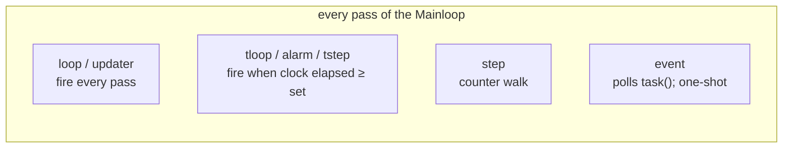
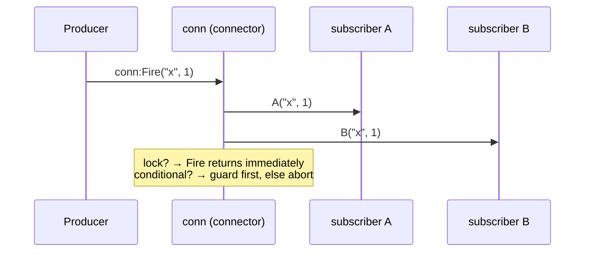

# Core API Reference

Part of the [Multi documentation suite](Documentation.md). Covers the type system, actors (scheduled tasks), timers, connections, the priority system, and utility functions. Threading and processors live in [Threading & Scheduling API](threading-api.md).

---

## Table of Contents

1. [The Type System](#the-type-system)
2. [Universal Actor Methods](#universal-actor-methods)
3. [Actors (Scheduled Tasks)](#actors-scheduled-tasks)
   - [newLoop](#newloop) · [newTLoop](#newtloop) · [newAlarm](#newalarm) · [newStep](#newstep) · [newTStep](#newtstep) · [newEvent](#newevent) · [newUpdater](#newupdater)
4. [Timers & Timeouts](#timers--timeouts)
   - [newTimer](#newtimer) · [SetTime / ResolveTimer](#settime--resolvetimer-actor-timeouts) · [setTimeout](#settimeout)
5. [Connections](#connections)
   - [Creating](#newconnection) · [Fire / Connect / Unconnect](#fire--connect--unconnect) · [Named connections](#named-connections) · [Locking](#locking) · [Composition operators](#composition-operators) · [Destroy](#destroy)
6. [Priority System](#priority-system)
7. [Logging](#logging)
8. [Utility Functions](#utility-functions)
9. [UUID v7 Utilities](#uuid-v7-utilities)
10. [Special System Connections](#special-system-connections)

---

## The Type System

Multi identifies every object with a registered string type. `multi.registerType(typ, plural)` registers a type, creates the constant `multi.$<UPPER>` (underscores stripped), and records the type for tooling.

```lua
local myType = multi.registerType("myObject", "myObjects")
-- multi.$MYOBJECT == "myObject"
```

| Function | Returns | Description |
|---|---|---|
| `multi.registerType(typ, plural?)` | `typ` | Registers a type (idempotent) |
| `multi.hasType(typ)` | `typ` or `nil` | True-ish check for a registered type |
| `multi.getTypes()` | table of `{typ, plural}` | All registered types |
| `multi.isMulitObj(obj)` | boolean | True if `obj.Type` is a registered multi type |
| `obj:isType(type)` / `obj:getType()` | boolean / string | Instance type checks |

### Built-in types

| Type | Constant | Created by |
|---|---|---|
| `rootprocess` | `multi.$ROOTPROCESS` | the `multi` table itself |
| `process` | `multi.$PROCESS` | `newProcessor` |
| `loop` / `tloop` | `multi.$LOOP` / `multi.$TLOOP` | `newLoop` / `newTLoop` |
| `alarm` | `multi.$ALARM` | `newAlarm` |
| `step` / `tstep` | `multi.$STEP` / `multi.$TSTEP` | `newStep` / `newTStep` |
| `event` / `updater` | `multi.$EVENT` / `multi.$UPDATER` | `newEvent` / `newUpdater` |
| `timer` / `timemaster` | `multi.$TIMER` / `multi.$TIMEMASTER` | `newTimer` / `SetTime` |
| `thread` | `multi.$THREAD` | `newThread` |
| `connector` | `multi.$CONNECTOR` | `newConnection` |
| `function` | `multi.$FUNCTION` | `thread:newFunction` (TFunc) |
| `service` | `multi.$SERVICE` | `newService` |
| `TIMEOUT` | `multi.TIMEOUT` | timeout sentinel value |
| `NIL` | `multi.NIL` | non-nil stand-in for a `nil` first return of a hold |

### Destroyed objects

`multi.setType(obj, multi.DestroyedObj)` converts an object into a *black hole*: its table is emptied and every metamethod (`__index`, `__call`, arithmetic, concatenation…) returns another inert stub. `tostring` yields `"destroyed"`. `multi.DestroyedObj` (alias `multi.DESTROYED`) is the sentinel. Services use this after `Destroy()`.

---

## Universal Actor Methods

Every actor (anything with an `Act()` method scheduled in a Mainloop) supports:

| Method | Returns | Description |
|---|---|---|
| `:Pause()` | self | Stops scheduling. The actor's `Act` is swapped for a no-op; the original is kept in `_Act`. |
| `:Resume()` | self | Restores the original `Act`. For processes, also resumes all children. |
| `:Destroy()` | self | Removes the actor from its parent's Mainloop permanently; fires `OnObjectDestroyed`. |
| `:Break()` | — | Pauses, sets `Active = nil`, fires `OnBreak`. |
| `:isPaused()` | boolean | `not Active` |
| `:isActive()` | boolean | `Active` |
| `:isDone()` | boolean | `Active ~= true` |
| `:Reset(n?)` | self | Generally an alias for `Resume()`; actor-specific where noted |
| `:setName(name)` | self | Human-readable name (`obj.Name`) |
| `:getName()` / `:getFullName()` | string | Name / full dotted path |
| `:setPriority(s)` | self | See [Priority System](#priority-system) |
| `:ResetPriority()` | self | Restore the priority captured at first `setPriority` |
| `:reallocate(processor, index?)` | self | Move the actor to another processor's Mainloop at `index` |
| `:IsAnActor()` | boolean | True when the object has an `Act` method |
| `:GetCreationTimestamp()` | string | ISO-8601 creation time (from the object's UUID v7 `UID`) |
| `OnBreak` | connection | Fires on `:Break()` |
| `OnPriorityChanged` | connection | Fires `(self, newPriority)` when `setPriority` changes a string-set priority |

Actors created via `newBase` also receive a UUID `UID` and `UPTIME` on registration (`multi:create`).

---

## Actors (Scheduled Tasks)

All constructors exist on `multi` **and** on any processor (`proc:newLoop(...)` etc.). They return `(actor, err)` — `err` is non-nil only when the processor refuses creation (e.g. `MaxObjects`).



### newLoop

Fires `OnLoop` **every scheduler pass**.

```lua
local loop = multi:newLoop(func?, notime?)
```

| Parameter | Type | Default | Description |
|---|---|---|---|
| `func` | function | nil | connected to `OnLoop` |
| `notime` | boolean | false | when true, the `elapsed` argument is always `nil` (skips clock math) |

**Callback:** `function(self, elapsed, dt)` — `elapsed` = seconds since creation.

```lua
local loop = multi:newLoop(function(self, elapsed)
    if elapsed > 5 then
        print("5 seconds!")
        self:Destroy()
    end
end)
```

### newTLoop

A loop that fires at a fixed interval. Internally holds a `newTimer`; priority defaults to **Low**.

```lua
local tloop = multi:newTLoop(func?, interval?)   -- interval seconds, default 0
```

**Callback:** `function(self, life, dt)` — `life` is the tick counter (1-based).

| Method | Description |
|---|---|
| `:Set(n)` | change the interval |
| `:Pause()` / `:Resume()` | also pause/resume the internal timer (paused time is not counted) |

```lua
multi:newTLoop(function(self, ticks)
    print("Tick #" .. ticks)
    if ticks >= 10 then self:Destroy() end
end, 2)
```

### newAlarm

A one-shot countdown. On expiry it pauses itself (`Active = false`) and fires `OnRing`; **reset it manually** to reuse. Priority defaults to **Low**.

```lua
local alarm = multi:newAlarm(seconds?, func?)   -- default 0
```

**Callback:** `function(self, dt)`.

| Method | Description |
|---|---|
| `:Reset(n?)` | optionally set a new duration, resume, restart the clock |
| `:Pause()` | freeze remaining time |
| `:Resume()` | continue from the frozen point |

```lua
local alarm = multi:newAlarm(3, function(self)
    print("3 seconds passed")
    self:Reset()      -- fire again in 3s; Reset(5) → 5s
end)
```

### newStep

A parallel-safe counter: think `for i = start, endAt, count do` — but stepping once per scheduler pass (or every `skip+1` passes).

```lua
local step = multi:newStep(start?, endAt?, count?, skip?)
-- defaults: start=1, endAt=math.huge, count=1, skip=0
```

- Counts *down* automatically when `start > endAt`.
- `skip` inserts dead passes between steps (`skip=1` → runs every other pass).

**Connections:**

| Connection | Fires | Arguments |
|---|---|---|
| `OnStart` | when position equals `start` | `(self)` |
| `OnStep` | every executed step | `(self, pos, dt)` |
| `OnEnd` | when the previous position hit `endAt` (then position is restored to `start` and the step pauses) | `(self)` |

**Methods:** `:Update(start?, endAt?, count?, skip?)` (re-parameterizes and resumes), `:Count(n)`, `:Break()` (hard stop, `Active = nil`).

```lua
multi:newStep(1, 5):OnStep(function(self, pos) print("Step", pos) end)
             :OnEnd(function(self) self:Destroy() end)
```

### newTStep

`newStep` advanced by **time** instead of passes. Wraps `newStep`, changes the type to `tstep`, priority **Low**.

```lua
local tstep = multi:newTStep(start?, endAt?, count?, interval?)  -- interval default 1s
```

Adds `:Set(n)` (interval) and `:Reset(n?)` (restart clock, optionally new interval). `:Update(start, endAt, count, set)` resets position and clock.

```lua
-- 1 … 10, one value per second
multi:newTStep(1, 10, 1, 1):OnStep(function(self, pos) print(pos) end)
```

### newEvent

Polls a `task` function every pass; when it returns a truthy value the event pauses itself, stores the value in `self.returns`, fires `OnEvent`, and **stays done** until `:Reset()`/`:Resume()`.

```lua
local ev = multi:newEvent(task?, handler?)
```

**Callback:** `function(self, dt)`; read the trigger value from `self.returns`. `:SetTask(func)` replaces the poller. Known quirk: `newEvent` calls `setPriority("core")` on the *creating object* rather than on the event itself — and since `setPriority` is a no-op on processors, the call currently does nothing.

```lua
local flag = false
multi:newEvent(function() return flag end, function(self)
    print("flag became", self.returns)
end)
-- later, somewhere else: flag = "ready"
```

### newUpdater

Frame-skip loop: fires `OnUpdate` once every `skip` passes. (Historically a poor-man's priority; prefer the real [priority system](#priority-system) unless you want zero scheduler overhead.)

```lua
local up = multi:newUpdater(skip?, handler?)   -- skip default 1 (every pass)
```

`:SetSkip(n)` changes the cadence.

---

## Timers & Timeouts

### newTimer

A plain stopwatch object (not an actor; created via `:create` bookkeeping only).

```lua
local t = multi:newTimer()
t:Start()            -- (re)start; alias :Reset()
print(t:Get())       -- elapsed seconds (respects pause)
t:Pause(); t:Resume()
print(t:isPaused())
```

Paused intervals are excluded from `Get()` — a timer paused after 1 s and resumed 1 s later reports 2 s, not 3 s.

### SetTime / ResolveTimer (actor timeouts)

Any actor can be given a deadline. `SetTime` spawns a hidden `timemaster` actor that watches a timer; if the deadline passes without resolution, the *actor* is paused and `OnTimedOut` fires. Resolving fires `OnTimerResolved` and also pauses the actor (the timemaster destroys itself).

```lua
local loop = multi:newLoop(function(self)
    if done() then self:ResolveTimer("success") end
end)

loop:SetTime(3)                       -- default 3 if n omitted
loop.OnTimedOut(function(self, dt) print("too slow") end)
loop.OnTimerResolved(function(self, ...) print("resolved", ...) end)
```

| Connection | Fires |
|---|---|
| `OnTimedOut` | `(actor, dt)` when the deadline expires |
| `OnTimerResolved` | `(actor, ...)` with the varargs of `ResolveTimer` |

### setTimeout

Fire-and-forget delay implemented as a thread:

```lua
multi.setTimeout(function() print("later") end, 2)   -- 2 seconds
```

### newTimeout

A connection factory built on an alarm: the returned connection fires once `timeout` seconds later with a `multi.TIMEOUT`-typed payload, and the underlying alarm destroys itself on ringing.

```lua
local conn = multi:newTimeout(5)
conn(function(payload)
    -- payload.Type == multi.TIMEOUT
end)
```

Prefer `thread.hold(cond, {sleep=n})` / `isTimeout` for new code; `newTimeout` is retained for compatibility.

### multi.timer (stopwatch a call)

```lua
local elapsed, ret1, ret2 = multi.timer(someFunc, arg1, arg2)
```

---

## Connections

Connections are multi's event channels: one producer broadcasts, many subscribers listen.



### newConnection

```lua
local conn = proc:newConnection(protect?, conditional?, kill?)
```

| Parameter | Type | Default | Description |
|---|---|---|---|
| `protect` | boolean | false | wrap each callback in `pcall`; errors route to `multi.error` instead of propagating |
| `conditional` | function | nil | **guard**: stored as `conn.conditional`, called with the Fire args before dispatch; if it returns falsy the whole Fire is skipped. It is *not* a subscriber — connect separately with `:Connect` |
| `kill` | boolean | false | one-shot: every subscriber is removed after being called (queue semantics) |

### Fire / Connect / Unconnect

| Member | Description |
|---|---|
| `:Fire(...)` | call every subscriber with `...`. No-op while locked or when the `conditional` guard rejects. |
| `:Connect(func, name?)` → `handle` | subscribe. Returns a handle table. Shorthand: calling the connection itself, `conn(func)`, is identical. |
| `handle:Unconnect()` | remove this subscription |
| `:Unconnect(handle)` | same, from the connection side |
| `:hasConnections()` | any subscribers? |
| `:getConnection(name)` | a callable stub for a named subscription (`stub:Fire(...)` runs just that one) |
| `:Get()` / `:getConnections()` | the internal ordered callback table |
| `:Bind(t)` | atomically swap the callback table; returns the old one. `conn:Remove()` empties it (returns old). |
| `:Hold(opt?)` | inside a thread, yield until the connection fires; returns the Fire args (see [threading API](threading-api.md#holding-on-a-connection)) |
| `:Destroy()` / `:destroy()` | full teardown (see below) |

```lua
local onClick = multi:newConnection()
local handle = onClick:Connect(function(btn) print("clicked", btn) end)
onClick:Fire("start")          -- "clicked start"
handle:Unconnect()
onClick:Fire("start")          -- nothing
```

Subscription handles are *proxy tables*: reading unknown fields forwards to `handle.root_link` if set, so operator pipelines can stash back-references.

### Named connections

```lua
local h = conn:Connect(myFunc, "bob")
conn:getConnection("bob"):Fire(1, 2)   -- fire only bob
```

Unnamed subscriptions get auto names `Conn_<12-char-ref>`; a 24-char random `ref` is always available on the handle.

### Locking

```lua
conn:Lock()      -- global: Fire becomes a no-op
conn:Unlock()
conn:Lock(handle)   -- temporarily silence ONE subscriber (used internally by AND gates)
conn:Unlock(handle)
```

### Composition operators

Connections overload Lua operators to build event pipelines. Every operator creates a **child connection** owned by the parent, so `Destroy()` cascades.

| Expression | Name | Behavior |
|---|---|---|
| `a + b` | **OR** | new conn fires whenever *either* fires (args forwarded) |
| `a * b` | **AND** | fires only after **all** chained sources have fired once (then resets). Chaining `a * b * c` counts up to 3. |
| `f % conn` | **MAP** | new conn fires with `f(...)` results. `conn % f` maps *in place* across all existing subs and re-wires new ones. |
| `f / conn` | **FILTER** | `f` must return a truthy guard as its first value; remaining return values are forwarded |
| `f .. conn` | **GATE** | new conn fires (and forwards to `conn`) only when `f(...)` returns `true` |
| `conn .. f` | **SPLIT/COND** | calls `f` alongside forwarding to `conn`; once `f` returns truthy, subsequent emissions are gated by `f` |
| `-conn` | **RAW MOUNT** | re-binds existing callbacks raw (advanced; used by internal tooling) |
| `multi.forwardConnection(src, dst)` | forward | `src(...)` → `dst:Fire(...)`; returns the subscription handle |

```lua
-- AND: wait until both players are ready
local both = playerA.OnReady * playerB.OnReady
both(function() startMatch() end)

-- MAP: double every value
local doubled = function(x) return x * 2 end % source
doubled(print)                       -- source:Fire(4) → 8

-- FILTER: keep only even numbers
local evens = function(x) return x % 2 == 0, x end / source
evens(print)

-- GATE: forward to save only when cheat is disabled
local saver = function(state) return not state.cheat end .. saveConn
```

**AND note:** `OnReturn + OnReturn` style merges are how `thread.hold` waits on several TFuncs at once; merged connections avoid the old "first arrival locks the hold forever" bug.

### Destroy

```lua
conn:Destroy()
```

Unlocks, recursively destroys operator children, clears all callbacks, decrements the parent's `connection_subscriptions`, removes itself from the parent's `connection_count`, and replaces `Connect/Fire/Bind/Unconnect/Lock/Unlock` with safe no-op stubs (`Connect` warns). Idempotent.

---

## Priority System

Priorities are weights chosen from powers of 4. They matter **only** when the priority-aware runner is active (`init{priority=true}` or a processor built with `Priority`).

| Constant | Value | Effective rate (priority runner) |
|---|---|---|
| `multi.Priority_Core` | 1 | every pass |
| `multi.Priority_Very_High` | 4 | 1 in 4 passes |
| `multi.Priority_High` | 16 | 1 in 16 |
| `multi.Priority_Above_Normal` | 64 | 1 in 64 |
| `multi.Priority_Normal` | 256 | default |
| `multi.Priority_Below_Normal` | 1024 | 1 in 1024 |
| `multi.Priority_Low` | 4096 | |
| `multi.Priority_Very_Low` | 16384 | |
| `multi.Priority_Idle` | 65536 | rarest |

How it works: on each pass `i` of the 9-step cycle, an actor runs when `PList[i] % actor.Priority == 0` — i.e. a *higher* weight means *fewer* executions. `multi.PriorityResolve[value]` maps a weight back to a display name.

```lua
actor:setPriority("high")            -- string
actor:setPriority(m.Priority_High)   -- or numeric
actor:ResetPriority()
actor.OnPriorityChanged(function(self, p) print(p) end)
```

Accepted strings (case-insensitive): `core/c`, `very high/vh`, `high/h`, `above/a`, `normal/n`, `below/b`, `low/l`, `very low/vl`, `idle/i`.

`setPriority` is a no-op on processors and non-actors. The first call captures `defPriority` for `ResetPriority`.

> Advanced: pluggable schemes (RoundRobin / PriorityBased / TimeBased profiling) are covered in [integrations → priorityManager](integrations.md#prioritymanager).

---

## Logging

All log helpers respect the [init settings](Documentation.md#initialization--settings) and use ANSI colors.

| Function | Gate | Format |
|---|---|---|
| `multi.print(...)` | `print=true` | `INFO:` blue |
| `multi.warn(...)` | `warn=true` | `WARNING:` yellow |
| `multi.debug(...)` | `debugging=true` | `DEBUG:` + process/task + traceback |
| `multi.error(self?, err)` | always prints; `error=true` escalates | `ERROR:` red, then `error()` + `os.exit(1)` |
| `multi.success(...)` | always | `SUCCESS:` green |

`multi.error` tolerates being called as `multi.error(msg)` or `multi.error(obj, msg)` — matching how `OnError` connections fire.

---

## Utility Functions

| Function | Description |
|---|---|
| `multi.Round(n, places?)` | decimal rounding with epsilon correction |
| `multi.AlignTable(t)` | pad a 2-D table into aligned columns, return a string |
| `multi.ForEach(t, f)` | fast array iteration `f(t[i])` |
| `multi.randomString(n)` | random `[a-zA-Z0-9]` string |
| `multi.isTimeout(v)` | true when `v` is the TIMEOUT sentinel (`v.Type == multi.TIMEOUT` or the table itself) |
| `multi.setClock(f)` | swap the internal clock (e.g. `chronos.nanotime`) |
| `multi.getStats()` | per-processor snapshot: threads, tasks, connections, subscriptions |
| `multi:getChildren()` | the Mainloop array |
| `multi:getRunners()` | Mainloop minus internal (`__ignore`) actors |
| `multi:getThreads()` / `multi:getProcessors()` | thread list / all processors |
| `multi:getVersion()` | `multi.Version` |
| `multi:getPlatform()` | `"love2d"` / `"lanes"` (integration-dependent) |
| `multi:canSystemThread()` | false until an integration enables it |
| `multi:benchMark(seconds, priority?, label?)` | returns an actor with `OnBench(time, steps)` counting scheduler passes |
| `multi:enableLoadDetection()` / `multi:getLoad(loops?)` | benchmark max speed, then estimate 0–100 process load |
| `multi:endTask(TID)` | destroy a scheduled task by thread id (legacy) |
| `multi.unpack` / `multi.pack` | version-safe `table.unpack`/`table.pack` |
| `table.merge(t1, t2)` | deep merge (adds to the `table` global!) |
| `os.getOS()` | `"windows"` / `"unix"` (adds to `os`) |
| `os.sleep(n)` | blocking shell sleep — avoid in library code |
| `multi.setEnv(func, env)` | re-load a dumped function with a new environment |
| `multi.isolateFunction(func, env)` | setfenv (5.1) or dump+load (5.2+) isolation |

---

## UUID v7 Utilities

Every registered object gets a UUID v7 `UID` (48-bit Unix-ms timestamp prefix, version nibble `7`).

```lua
local id = multi.generate_uuid7()       -- "01937f3e-2c10-7a4b-9c2d-1f2e3d4c5b6a"
local info = multi.extract_uuid7_timestamp(id)
-- info.milliseconds, info.seconds, info.date ("YYYY-MM-DD HH:MM:SS"), info.iso8601
local created = someActor:GetCreationTimestamp()   -- iso8601
```

Timestamps are second-resolution × 1000 (sub-second component is zero) — fine for ordering and provenance, not for precise timing.

---

## Special System Connections

Root-level lifecycle connections:

| Connection | Fires |
|---|---|
| `multi.OnObjectCreated` | `(obj, parent)` from `multi:create` (and per-processor for children) |
| `multi.OnObjectDestroyed` | `(obj, parent)` when an actor/process is destroyed |
| `multi.OnLoad` | once before the first scheduler pass (also on first thread creation) |
| `multi.OnPreLoad` | at runner start and on the first `uManager` |
| `multi.OnError` | global error sink |
| `multi.OnExit` | when `os.exit()` is called (multi wraps `os.exit`) |
| `multi.settingsHook` | on every `init(settings)` |
| `multi.enableOptimization` | when `findopt` is active, at init |
| `multi.optConn` | optimization hints feed here; `multi:getOptimizationStats()` returns the collected list |

```lua
multi.OnExit(function(code) print("bye", code) end)
multi.OnObjectCreated(function(obj) print("created", obj.Type) end)
```
