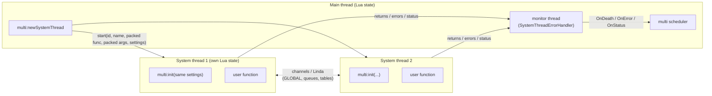
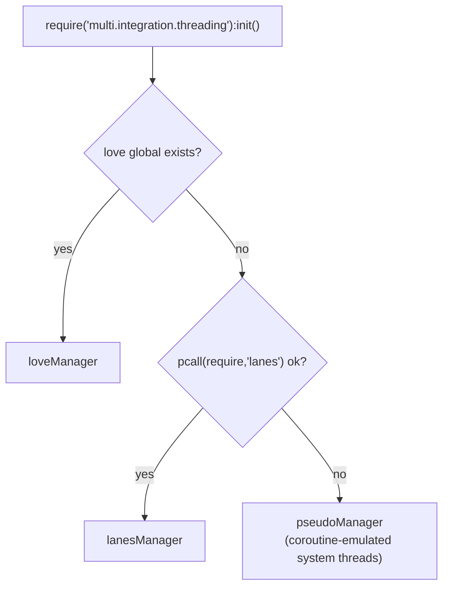
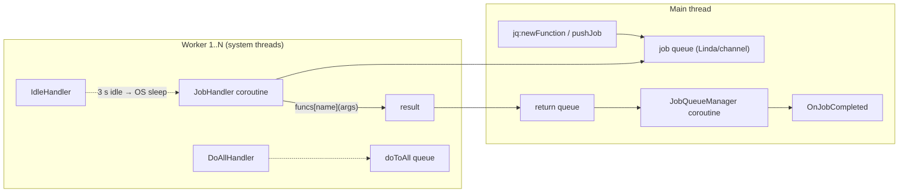

# System Threading & Integrations

Part of the [Multi documentation suite](Documentation.md). Covers real OS-level threads, the `GLOBAL`/`THREAD` compatibility layer, cross-thread data structures, remote object proxies, and every manager shipped in `multi/integration/`.

---

## Table of Contents

1. [How Integrations Work](#how-integrations-work)
2. [Auto-Detection](#auto-detection-threadinglua)
3. [The GLOBAL / THREAD Namespaces](#the-global--thread-namespaces)
4. [System Threads](#system-threads)
5. [System-Threaded Objects](#system-threaded-objects)
   - [Queue](#systemthreadedqueue) · [Table](#systemthreadedtable) · [Job Queue](#systemthreadedjobqueue) · [Connection](#systemthreadedconnection)
6. [Proxies & System-Threaded Processors](#proxies--system-threaded-processors)
7. [Environment Managers](#environment-managers)
   - [loveManager](#lovemanager) · [lanesManager](#lanesmanager) · [pseudoManager](#pseudomanager) · [lovrManager](#lovrmanager) · [luvitManager](#luvitmanager) · [effilManager](#effilmanager)
8. [debugManager](#debugmanager)
9. [priorityManager](#prioritymanager)
10. [networkManager (WIP)](#networkmanager-wip)

---

## How Integrations Work

The core library only knows coroutines. An **integration** teaches `multi` to spawn real OS threads and provides cross-thread communication primitives. Requiring an integration mutates the shared `multi` namespace, so afterwards `multi:newSystemThread(...)` and friends exist everywhere — including inside other threads.

```lua
local multi, thread = require("multi"):init()
local GLOBAL, THREAD = require("multi.integration.loveManager"):init()
-- multi:newSystemThread, multi:newSystemThreadedQueue, … now available
```

Every integration:

1. Implements `multi:newSystemThread(name, func, ...)` for its platform.
2. Implements `THREAD:newFunction(func, holdme)` (system-threaded TFuncs, type `s_function`).
3. Builds the `GLOBAL` (shared key/value space) and `THREAD` (helper namespace) objects and stores them on `multi.integration.GLOBAL/THREAD`.
4. Loads `extensions.lua` (queues/tables/job queues on native channels or Linda objects) and `sharedExtensions` (proxies, system-threaded processors).
5. Flips `multi.isMainThread = true`, `multi:canSystemThread() → true`, and reports `multi:getPlatform()`.



Because each system thread is a **separate Lua state**, functions and arguments must be transferable. LÖVE packs functions via `string.dump`; Lanes ships them through Linda message passing. Upvalues are *not* captured — pass data explicitly or use `GLOBAL`.

---

## Auto-Detection: threading.lua

The convenience module picks the best backend:

```lua
GLOBAL, THREAD = require("multi.integration.threading"):init()
```

Decision order:



---

## The GLOBAL / THREAD Namespaces

`GLOBAL` behaves like a shared table (backed by channels/Linda/real table depending on backend):

```lua
GLOBAL["config"] = { level = 3 }        -- visible to every thread
local cfg = GLOBAL["config"]
```

`THREAD` is the per-thread helper namespace (available inside system threads too, with the same API):

| Function | Description |
|---|---|
| `THREAD.set(name, val)` / `THREAD.get(name)` | read/write GLOBAL (explicit form) |
| `THREAD.waitFor(name)` | block until key exists, return it |
| `THREAD.getCores()` | physical cores |
| `THREAD.getName()` / `THREAD.getID()` | current thread identity (`MAIN_THREAD`/0 on main) |
| `THREAD.sleep(n)` | real OS sleep **inside a system thread** (blocks only that thread) |
| `THREAD.hold(fn)` | poll-and-wait inside a system thread |
| `THREAD.kill()` | terminate current system thread (raises `"Thread was killed!"`) |
| `THREAD.pushStatus(...)` | stream progress to main thread's `OnStatus` |
| `THREAD.getConsole()` | serialized console: `console.print(...)` / `console.error(err)` |
| `THREAD.getThreads()` | live thread table (lanes: `GLOBAL.__THREADS__`) |
| `THREAD.setENV(env, name?)` / `THREAD.getENV(name?)` / `THREAD.exposeENV(name?)` | publish an environment that new system threads merge into their globals (default key `__env`) |
| `THREAD.defer(fn)` | run `fn` when the system thread body finishes (cleanup) |
| `THREAD.sync()` | backend sync hook (pseudo: 0.5 s sleep; others: no-op) |

> Inside a system thread the core `thread.*` (coroutine) API *also* works — each system thread runs its own multi instance and scheduler.

---

## System Threads

```lua
local st = multi:newSystemThread(name?, func, ...)
```

| Member | Description |
|---|---|
| `st.Name`, `st.ID`, `st.Type` (`"s_thread"`) | identity |
| `st.OnDeath` | fires with the function's return values when it completes normally |
| `st.OnError` | fires `(st, errMsg)` on error/cancel |
| `st:kill()` | cancel (lanes: `thread:cancel()`; love: sentinel error) — main thread only |
| `st:getName()` | name |
| `st.statusconnector` | wired to `OnStatus` for `THREAD.pushStatus` streams |

Completion is not push-based: a monitor coroutine (`InitSystemThreadErrorHandler`, auto-started) polls thread status/channels every scheduler pass and fires `OnDeath`/`OnError`/`OnStatus` accordingly. **You must keep a runner going** (mainloop or uManager) for system thread results to be delivered.

```lua
local GLOBAL, THREAD = require("multi.integration.threading"):init()

multi:newSystemThread("Compute", function(payload)
    local result = heavy(payload)         -- real CPU parallelism
    return result
end, data):OnDeath(function(result)
    print("got", result)
end):OnError(function(st, err)
    print("boom", err)
end)
```

System-threaded TFuncs behave exactly like coroutine TFuncs:

```lua
local job = THREAD:newFunction(function(a, b) return a + b end)
job(1, 2):connect(print)        -- or job(1,2).wait() inside a thread
```

---

## System-Threaded Objects

Named objects auto-register into `GLOBAL`; other threads fetch them with `THREAD.waitFor(name):init()`.

### SystemThreadedQueue

FIFO across threads (love: `love.thread.getChannel`; lanes: Linda `Q` key; pseudo: plain table).

```lua
local q = multi:newSystemThreadedQueue("myQueue"):init()
q:push(data)          -- producer
local d = q:pop()     -- consumer (nil if empty; blocking variants per backend)
local d2 = q:peek()   -- inspect without removing
thread.hold(q)        -- or q:Hold(opt) — wait inside a coroutine thread
```

### SystemThreadedTable

Shared key/value map with `__index`/`__newindex` proxies:

```lua
local stt = multi:newSystemThreadedTable("stt"):init()
stt.hello = "world"
-- in another thread:
local stt = GLOBAL["stt"]:init()
print(stt.hello)      -- world
```

`stt:Hold({key=...})` waits for a specific key to appear.

### SystemThreadedJobQueue

The workhorse: a pool of `cores` system-thread workers pulling jobs from a shared queue, with a main-thread result collector.

```lua
local jq = multi:newSystemThreadedJobQueue(4)   -- default cores*2
```

| Member | Description |
|---|---|
| `jq.cores` | worker count |
| `jq:isEmpty()` | job queue drained? |
| `jq:doToAll(func, ...)` | run `func` once in *every* worker (require modules, set globals) |
| `jq:registerFunction(name, func)` | make `func` callable by name on all workers |
| `jq:pushJob(name, ...)` | enqueue; returns job id |
| `jq.OnJobCompleted` | fires `(jid, returns...)` |
| `jq:newFunction(name?, func, holup?)` | registers + returns a TFunc wrapper with `wait()`/`connect()` |
| `jq:Hold(opt)` | `thread.hold(jq.OnJobCompleted)` |

Worker anatomy (lanes backend; love mirrors it):



```lua
local jq = multi:newSystemThreadedJobQueue(4)
jq:doToAll(function() IMPORTANT = 15 end)       -- shared env in every worker
jq:registerFunction("test", function(a, b) return a + b end)
jq.OnJobCompleted(function(jid, ret) print(jid, ret) end)
jq:pushJob("test", 10, 5)

local mul = jq:newFunction("mul", function(a, b) return a * b end)
print(mul(6, 7).wait())                          -- 42 (blocking)
mul(2, 3):connect(function(r) print(r) end)      -- 6 (async)
```

Registered functions can call each other by name — the worker table metatable is `{__index = funcs}`.

### SystemThreadedConnection

A connection whose `Fire` crosses thread boundaries via a ping/pong protocol (`CONN/TRIG/PING/PONG` opcodes) so a system thread can `:Fire` a main-thread connection (and vice versa). Use like a normal connection after `:init()`; `:Hold()` bridges into a coroutine wait.

---

## Proxies & System-Threaded Processors

`sharedExtensions` adds remote object access:

```lua
local handle = multi:chop(obj)          # snapshot callable/connection surface
local proxy  = multi:newProxy(handle):init()
proxy:someMethod(args)                  -- RPC over two queues, waits for reply
proxy:getTransferable()                 -- serializable form to ship elsewhere
```

- `chop` records the object's functions and connections; connections become nested proxies.
- The proxy's `init` on the far side rebuilds methods as TFuncs that push `{method, self?, args}` into a send queue and hold on a matching reply (with `SELF_REF`/`PARENT_REF` markers restored).

Built on this, `multi:newSystemThreadedProcessor(cores)` is a drop-in *processor-shaped* facade whose work actually happens on a job queue:

```lua
local stp = multi:newSystemThreadedProcessor(8)
local loop = stp:newLoop(function() end)     -- actor created on a worker, returned as proxy
local th   = stp:newThread("name", fn)       -- thread on a worker, returned as proxy
stp:newSharedTable("shared")
stp:pushJob(id, name, ...)
```

Implemented constructors: `newLoop, newTLoop, newUpdater, newEvent, newAlarm, newStep, newTStep, newService`, plus `newThread`, `newFunction`, `newSharedTable`. Start/Stop/run are no-ops (the job queue is self-driving). **Experimental** — expect rough edges.

---

## Environment Managers

### loveManager

Backend: **LÖVE 2D** (`love.thread`).

- Requires being run inside LÖVE; refuses to load inside a LÖVE thread (`ISTHREAD` guard).
- System threads are launched from an embedded chunk (`ThreadFileData`) that unpacks function/args via `packValue`/`unpackValue` (functions become `"\1\2:func:"..string.dump`), seeds `math.randomseed(THREAD_ID)`, merges `GLOBAL.__env`, and re-inits multi with the main settings.
- Completion detection: per-thread `stab` table (`returns` key) + `thread:getError()` sentinel `"Thread Killed!\1"`.
- `love.threaderror` is routed into `multi.error`.
- Queues/tables ride `love.thread.getChannel`; values are function-aware.
- In LÖVE, drive multi from `love.update` (`multi:uManager(dt)`) instead of `mainloop()`.

```lua
function love.update(dt) multi:uManager(dt) end
```

### lanesManager

Backend: **Lanes** (console Lua).

- Four Linda objects: `__GlobalLinda`, `__SleepingLinda`, `__ConsoleLinda`, `__StatusLinda`; plus a per-thread return Linda.
- Workers get a `globals` table (`THREAD_NAME`, `THREAD_ID`, `THREAD`, `GLOBAL`, `_Console`, `_DEFER`) and re-init multi inside.
- `THREAD.kill()` raises `"Thread was killed!\1"`; status transitions (`done/cancelled/killed`) are polled by the monitor thread.
- Richest job-queue implementation (JobHandler/DoAllHandler/IdleHandler coroutines per worker).

### pseudoManager

Backend: **none** — emulates system threads with ISO coroutine threads on a dedicated processor. Same API surface (`newSystemThread`, queues, tables, job queues), but *no true parallelism*; `THREAD.sleep` becomes `thread.sleep`, `sync()` sleeps 0.5 s. Ideal for developing integration-aware code that must run anywhere. (Note: the require path spelling is `multi.integration.pesudoManager` in the auto-detector fallback, files live in `pseudoManager/`.)

### lovrManager

Backend: **lovr** (experimental, targets an older lovr API; marked TODO). Uses `lovr.thread`, `lovr.data` byte blobs for dumped functions, and static-table proxies. Treat as best-effort.

### luvitManager

Backend: **luvit**. Spawns luvit threads running the dumped function; `GLOBAL`/`THREAD` are inert stubs (no data passing yet). Basic only.

### effilManager

**Disabled.** Loading it prints an error and exits — current effil limitations (upvalue handling) block the integration. Code skeleton remains for a future revival.

---

## debugManager

Auto-loaded when `init{debugging=true}`, or require it explicitly (`require("multi.integration.debugManager")`). It hooks `OnObjectCreated/OnObjectDestroyed` on `multi` and the thread manager (and recursively on new processors) and exposes:

```lua
multi.debugging:getObjects("thread")            -- all live threads
multi.debugging:getObjects(someProcessor)       -- children of a processor
multi.debugging:getObjects(function(obj)        -- predicate; return "break" to stop
    return obj.Name:find("Worker")
end)

multi.debugging.OnObjectCreated(function(obj, proc) ... end)
multi.debugging.OnObjectDestroyed(function(obj, proc) ... end)
```

A dedicated `Debug_Processor` runs de-duplication housekeeping. (Known quirk: the destruction hooks are attached with a misspelled local, so processor-level destruction tracking may be unreliable in some builds.)

---

## priorityManager

Optional advanced scheduler (`require("multi.integration.priorityManager")`). Requires **chronos** for the useful mode; without it, scheme registration still loads but time-based management warns.

Schemes (`multi.priorityScheme`):

| Scheme | Runner | Behavior |
|---|---|---|
| `RoundRobin` | `mainloopRef`/`uManagerRef` | default pass-per-actor |
| `PriorityBased` | `p_mainloop`/`uManagerRefP1` | static weights |
| `TimeBased` | priority runner + profiling processor | actors are *temporarily reallocated* to a profiling processor; each `Act()` is timed with `chronos.nanotime`; after `PROFILE_COUNT` samples the actor's average runtime maps to a priority bucket (0.2 ms → Core … >10 ms → Idle) and it is reallocated back |

```lua
multi:setPriorityScheme(multi.priorityScheme.TimeBased)
multi:setProfilerCount(8)      -- samples per calibration
multi:recalibrate()            -- re-profile everything currently scheduled
```

Extend with `multi:registerScheme(name, {mainloop=…, umanager=…, condition=…, static=…})`. The manager runs on its own `Priority Manager` processor (thread spawning and nested scheme changes are blocked there).

---

## networkManager (WIP)

Distributed-node experiments: `nodeManager` (UDP discovery port), `masterNode`/`childNode`/`node` (register, ping, broadcast), `channel`, `cmds`, plus network-threaded queues. **Under rework — not part of the supported API.** The `NetworkManager.md` planning file at the repo root tracks intended `NTHREAD.*` additions. Do not build on it yet.
