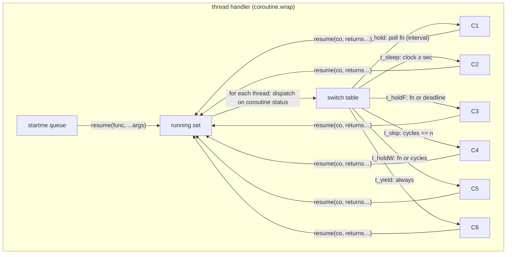

# Threading & Scheduling API

Part of the [Multi documentation suite](Documentation.md). Covers coroutine-based threads, yield primitives, threaded functions, processors, services, tasks, and cron-style jobs. For OS-level threads see [System Threading & Integrations](integrations.md).

---

## Table of Contents

1. [Coroutine Threads](#coroutine-threads)
   - [newThread](#newthread) · [Thread control](#thread-control-pause-resume-kill) · [newISOThread](#newisothread)
2. [Yield Primitives](#yield-primitives)
   - [sleep](#threadsleepn) · [hold](#threadholdn-opt) · [yield / skip](#threadyield--threadskip) · [holdFor / holdWithin](#threadholdfor--threadholdwithin) · [chain](#threadchain) · [Holding on a connection](#holding-on-a-connection)
3. [Thread Utilities](#thread-utilities)
4. [Threaded Functions (TFunc)](#threaded-functions-tfunc)
5. [Processors](#processors)
6. [Services](#services)
7. [Tasks (Deferred Work)](#tasks-deferred-work)
8. [Scheduled Jobs (Cron)](#scheduled-jobs-cron)

---

## Coroutine Threads

Threads are coroutines driven by the thread handler of a processor (or the global `Global_Thread_Manager` when created on `multi`). They interleave with all actors in the same scheduler.



### newThread

```lua
local th = multi:newThread(name?, func, ...)
-- name may be omitted (auto "UnnamedThread_xxxx"); func may take the name slot
```

Arguments after `func` are passed to the function on its first resume.

**Thread object members:**

| Member | Description |
|---|---|
| `th.Name`, `th.Type` (`"thread"`), `th.TID` | identity |
| `th.OnError` | fires `(self, err)` on runtime error (protected, one-shot connection) |
| `th.OnDeath` | fires with the function's return values when it ends normally (also on kill) |
| `th:getName()` / `th:isPaused()` | accessors |
| `th:GetCreationTimestamp()` | ISO time from the thread's UID |

### Thread control: Pause / Resume / Kill

`th:Pause()`, `th:Resume()`, `th:Kill()`, `th:Sleep(n)`, `th:Hold(n, opt)` are **requests** — they are queued and executed *at the thread's next yield point* (`thread.request`). A well-behaved thread cooperates; a thread that never yields never notices.

```lua
local th = multi:newThread("Worker", function()
    while true do
        work()
        thread.yield()          -- control point: Pause/Kill take effect here
    end
end)

th:Pause()     -- parks at next yield until Resume
th:Resume()
th:Kill()      -- == Destroy: raises inside the thread → OnDeath("Thread Killed!")
```

### newISOThread

A thread whose function is re-loaded into an isolated environment — no access to the defining chunk's upvalues or globals. `thread` and `multi` are auto-injected into `env` if absent.

```lua
local a = "outer"
multi:newISOThread("ISO", function()
    print(a)                 -- nil! upvalues stripped
    thread.sleep(1)
end, { print = print })       -- explicitly expose what you need
```

> On Lua 5.2+/LuaJIT isolation works via `string.dump` + `load`; closures with upvalues cannot cross that boundary.

---

## Yield Primitives

These are called **inside** thread bodies. Every one of them first flushes pending cross-thread requests (`thread._Requests`).

### `thread.sleep(n)`

Park for `n` seconds (default 1). Returns after the wall clock passes; nothing else about the program is delayed.

### `thread.hold(n, opt?)`

The universal wait. `n` may be:

| `n` is… | Behavior |
|---|---|
| function | poll it (each pass, or every `opt.interval` seconds); resume when it returns truthy, **forwarding its return values** as the result of `hold` |
| connection | wait for one `Fire`; result = the fired args |
| object with `:Hold()` | delegate (threaded queues/tables/job queues implement this) |
| number | same as `thread.sleep(n)` (options ignored) |

`opt` table (only meaningful with a function/connection):

| Key | Meaning |
|---|---|
| `interval` | min seconds between polls |
| `sleep` | deadline in seconds → on expiry resume with `(nil, multi.TIMEOUT)` |
| `cycles` | deadline in passes → TIMEOUT like above |
| `skip` | wait `n` passes then resume (no timeout value) |

On a *successful* hold the condition function's return values become `hold`'s return values, which is how `func(...)` results flow back:

```lua
local value = thread.hold(function()
    if dataReady() then return payload end     -- payload returned by hold
end)
```

**multi.NIL:** a hold that returns literally `nil` as its first value would be indistinguishable from "not ready". Return `multi.NIL` instead to force a null through; consumers detect it and the hold yields `nil` to you. Never use `multi.NIL` outside hold-style methods.

Timeout detection:

```lua
local ok, why = thread.hold(cond, { sleep = 5 })
if multi.isTimeout(why) then print("timed out") end
```

### `thread.yield()` / `thread.skip(n)`

- `thread.yield()` — hand control back for exactly one handler pass.
- `thread.skip(n)` — resume after `n` passes (default 1).

### `thread.holdFor(sec, cond?)` / `thread.holdWithin(cycles, cond?)`

Legacy spellings of `hold(cond, {sleep=sec})` and `hold(cond, {cycles=cycles})`. With no condition they behave as sleep / skip.

### `thread.chain(...)`

Sequentially `hold` on each argument in order — a tiny sequencer:

```lua
thread.chain(
    function() return phase1Done() end,
    startSignalConn,
    function() return phase3Done() end
)
print("all phases complete, in order")
```

### Holding on a connection

```lua
local conn = multi:newConnection()
local th = multi:newThread("Waiter", function()
    local a, b = thread.hold(conn)      -- resumes with Fire args
    print(a, b)
end)
conn:Fire("hello", 42)
```

Equivalent sugar from the connection side: `conn:Hold()` (used inside threads).

---

## Thread Utilities

| Function | Description |
|---|---|
| `thread.isThread()` | true when running inside a coroutine thread |
| `thread.getRunningThread()` | the thread object owning the current coroutine (nil outside) |
| `thread.set(k, v)` / `thread.get(k)` | shared `multi.GlobalVariables` blackboard (coroutine threads only) |
| `thread.waitFor(k)` | hold until `thread.get(k) ~= nil`, then return it |
| `thread.pushStatus(...)` | fire the current thread's `OnStatus` (see TFunc) |
| `thread.defer(fn)` | run `fn(th)` when the current thread dies **or** errors (cleanup hook) |
| `thread.request(th, cmd, ...)` | queue a command (`exec`, `kill`, …) on another thread |
| `thread.exec(fn)` | run `fn()` at the next control point of the current thread |
| `thread.getCores()` | physical core count (detected at load) |
| `thread.kill(msg)` | raise inside the current thread (kills it) |
| `multi.hold(cond, opt?)` | **outside** any thread: spins `uManager` internally until the condition resolves, then returns its values. Pauses/resumes the current task around the spin. |

---

## Threaded Functions (TFunc)

A TFunc is a reusable callable that runs its body on a fresh thread per call. It is the bridge between "async" and "looks like a function".

```lua
local tfunc = thread:newFunction(func, holdme?)   -- or proc:newFunction(...)
```

### Calling

```lua
local handle = tfunc(arg1, arg2)     -- spawns a thread, returns a handle
```

While the TFunc is **paused** (`tfunc:Pause()`), calls short-circuit: `holdme` calls return `nil, "Function is paused"`, otherwise the handle's `wait()` yields that error and `connect(f)` immediately calls `f(nil, "Function is paused")`.

### Handle

| Member | Description |
|---|---|
| `handle.isTFunc` | true marker |
| `handle:wait()` | block until done; returns the function's return values. Inside a thread it uses `thread.hold`; outside it spins `uManager`. On error returns `nil, err`. |
| `handle:connect(f)` | `f(returns…)` on success / `f(nil, err)` on error; returns a protected connection if `f` is omitted |
| `handle.OnReturn` | connection: fires with return values |
| `handle.OnError` | connection: fires `(err)` |
| `handle.OnStatus` | connection: fires values pushed by `thread.pushStatus(...)` inside the body |
| `handle.getReturns()` | raw returns after completion |

TFunc object methods: `:Pause()`, `:Resume()`, `:holdMe(bool)` (toggle blocking mode), `GetCreationTimestamp()`.

### Progress reporting example

```lua
local countUp = thread:newFunction(function(n)
    for i = 1, n do
        thread.sleep(0.1)
        thread.pushStatus(i, n)          -- → OnStatus(i, n)
    end
    return "done"
end)

multi:newThread("Caller", function()
    local a, b, c = countUp(5), countUp(7), countUp(9)   -- three parallel runs
    a.OnStatus(function(part, whole) print(part .. "/" .. whole) end)
    thread.hold(a.OnReturn + b.OnReturn + c.OnReturn)     -- AND-merge of returns
    print("all done")
end)
```

`holdme = true` makes the call itself block until completion — usable only where spinning is acceptable (inside threads, or top-level before a mainloop):

```lua
local fetch = thread:newFunction(function(url)
    thread.sleep(1)
    return "data:" .. url
end, true)

local data = fetch("x")      -- blocks (internally) until ready
```

---

## Processors

A processor is a sandboxed scheduler: its own Mainloop, thread pool, task queue, connection counters, and optional caps. Killing the processor kills everything inside — ideal for feature toggles and teardown.

```lua
local proc = multi:newProcessor(name?, opts?, priority?)
```

Legacy form: `multi:newProcessor(name, nothread)` — passing `false` for `nothread` attaches the processor to the parent loop.

### Options

| Option | Type | Default | Description |
|---|---|---|---|
| `Start` | boolean | false | run immediately |
| `Priority` | any | nil | use the priority-aware thread handler for this processor |
| `MaxThreads` | number | -1 | cap (`-1` = unlimited); exceeding returns `nil, statusString` |
| `MaxObjects` | number | -1 | cap on Mainloop actors |
| `TaskDelay` | number \| function | 0 | delay between queued task executions |
| `Attach` | boolean | false | drive the processor with a hidden `loop` actor on the **parent** (auto-run) |
| `TaskHandler` | boolean | true | spawn the built-in task-handler thread |

```lua
local worker = multi:newProcessor("Worker", { Start = true, MaxThreads = 8, Attach = true })
```

### Driving

- `Attach = true`: an attached loop actor (marked `__ignore`) calls `proc:uManager(true)` + handler every parent pass. Nothing else needed.
- Detached: call `proc.run(dt?)` yourself — from the host loop or a driver thread:

```lua
multi:newThread("Driver", function()
    while proc.isActive() do
        proc.run()
        thread.yield()
    end
end)
```

`proc:boost(n)` makes each `run()` perform `n` handler passes (throughput tuning).

### Processor members

| Member | Description |
|---|---|
| `proc.Start()` / `proc.Stop()` | activate / deactivate (all children idle while stopped) |
| `proc:isActive()` / `proc:isPaused()` | state |
| `proc:Destroy()` | stop + destroy attached loop |
| `proc:newThread(name, func, ...)` | thread owned by this processor (respects `MaxThreads`) |
| `proc:newFunction(func, holdme?)` | TFunc whose threads live in this processor |
| `proc:newLoop/newTLoop/newAlarm/...` | all actor constructors, scoped here |
| `proc:newTask(func)` | queue on this processor's task queue |
| `proc:getThreads()` / `proc:getHandler()` | introspection |
| `proc:getMaxThreads()` / `proc:setMaxThreads(n)` | caps |
| `proc:getMaxObjects()` / `proc:setMaxObjects(n)` | caps |
| `proc:setTaskDelay(d)` | number or function |
| `proc:getFullName()` | `"parent.child"` dotted path |
| `proc.OnError` | processor-level error sink (pre-wired to `multi.error`) |
| `proc.OnObjectCreated` | fires for objects created on this processor |
| `proc.Status` | recent status strings (cap violations etc.) |

Actors created on a processor can be moved with `actor:reallocate(otherProc, index?)`.

### thread:newProcessor (experimental)

Creates a *proxy* processor: actors added to it are converted into long-running threads on a real inner processor (each object's `Act` looped by a thread). Useful for moving actor-style code onto a thread-driven cadence. Expect log noise ("Converting … to thread!") and rough edges.

### threadManager

Threads created on `multi` actually live in a dedicated processor named `Global_Thread_Manager` (created at load, started, attached). Access it with `multi:getThreadManagerProcess()`; `multi:setTaskDelay` forwards to it.

---

## Services

A service is a long-running background worker implemented as a self-managing thread with priority-derived pacing. The body is called repeatedly while the service is active; it gets a private `data` table.

```lua
local svc = multi:newService(function(self, data)
    -- one unit of work per call
end)
svc.SetPriority(multi.Priority_Normal)
svc.Start()
```

| Member | Description |
|---|---|
| `svc.Start()` / `svc.Stop()` | start/stop; Stop clears `data` and resets the uptime timer |
| `svc.Pause()` / `svc.Resume()` | freeze/run without clearing data |
| `svc.Destroy()` | kill thread, stop, mark object `DestroyedObj` |
| `svc.GetUpTime()` | running seconds |
| `svc:SetPriority(p)` | priority constant/number — feeds the pacing scheme |
| `svc:SetScheme(n)` | pacing scheme (below) |
| `svc.OnStarted` / `svc.OnStopped` | lifecycle connections |
| `svc.OnError` | shares the worker thread's error connection |

**Schemes:**

| Scheme | Pacing |
|---|---|
| 1 (default) | `thread.sleep(p^(1/3)/10)` — time-based; at Normal this is ~0.1 s (`thread.yield`-equivalent cadence) |
| 2 | `thread.skip(|p-1|*32+1)` — cycle-based |
| 3 | reserved (time-per-workload scheme, unfinished) |

The classic use is a job manager (see [Advanced Patterns → service-backed job queue](advanced-patterns.md#service-backed-job-queue)).

---

## Tasks (Deferred Work)

`newTask` queues a one-shot function executed by the processor's task-handler thread (FIFO):

```lua
proc:newTask(function() cleanup() end)
proc:setTaskDelay(0.05)          -- pause between tasks
```

Internally `connection:Fire` with `kill`/`protect` schedules table-cleanup through tasks, so tasks are the library's own deferral mechanism too. Set `TaskHandler = false` on a processor to suppress the thread (you then drain `proc.tasks` yourself).

---

## Scheduled Jobs (Cron)

```lua
multi:scheduleJob(timeTable, func)
```

A lazily-started `JobScheduler` thread compares `os.date("*t")` against the table **every second**; the job runs once when *all* provided fields match, and re-arms when the fields stop matching.

| Field | Range | Repeats |
|---|---|---|
| `sec` | 0–59 | every minute |
| `min` | 0–59 | every hour |
| `hour` | 0–23 | every day |
| `day` | 1–31 | every month |
| `wday` | 0–6 | every week |
| `month` | 1–12 | every year |
| `year` | — | once |

```lua
multi:scheduleJob({ min = 30 }, function() print("every :30") end)
multi:scheduleJob({ min = 0, hour = 9, wday = 2 }, function() print("Mon 9:00") end)
```

Jobs live in a module-global list; there is currently no cancel API.
